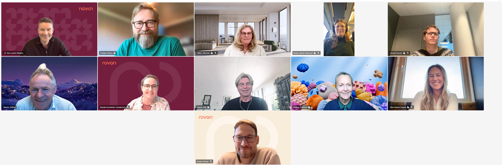

## Kick-off meeting for Pilot 2: Choice of educational path!

On Wednesday 6 May the kick-off meeting for Pilot 2: Choice of educational path was held. Participants from the SAMT-BU core team and resources for Pilot 2 attended. Pilot 2 will run from May to August 2026.

The pilot will be run as agile development with 3-week sprints. A common meeting structure (stand-up) has now been established, and we went through proposals for what the pilot should try to answer.

If you are interested in reading more about the project: Felles løft: Seamless services for children and young people (SAMT-BU), which runs from October 2025 to December 2027, see more information here: [https://docs.samt-bu.no/en/om/.](https://docs.samt-bu.no/en/om/)

Here (<https://docs.samt-bu.no/en/behov/use-cases/21-valg-utdanningsloep/>) case 21: Choice of educational path is also described further (the case may change as we work through the sprints).

Here are the participants at the kick-off meeting!

From top right: Jens Laurits Nielsen (Novari), Torbjørn Moen (KS Digital), Wenche Fylken (Digdir), Kjersti Stenerud Steien (Digdir), Harald Groven (HK-dir), Martin Zeiffert (Novari), Natalia Kovalenko-Gundersen (Novari), Erik Hagen (Digdir), Cat (Cahtrine) Holten (Digdir), Ellen Marite Fagerli (HK-dir) and Anders Alstad (Novari).
