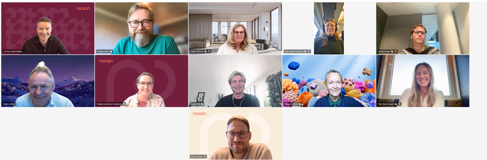

The tasks of pilot 2 are issues in [samt-bu-pilot-2](https://github.com/samt-x/samt-bu-pilot-2/issues) and on the board [SAMT-BU Pilot 2 – Valg av utdanningsløp](https://github.com/orgs/samt-x/projects/2) (Project 2). This page shows where the work stands.

| View | Shows |
|---|---|
| [Board](https://github.com/orgs/samt-x/projects/2/views/1) | All tasks by status |
| [By responsible](https://github.com/orgs/samt-x/projects/2/views/2) | The tasks grouped by who is responsible |
| [Open tasks](https://github.com/orgs/samt-x/projects/2/views/3) | Open tasks in a table |
| [My tasks](https://github.com/orgs/samt-x/projects/2/views/5) | Your tasks (requires login) |
| [Timeline](https://github.com/orgs/samt-x/projects/2/views/4) | GitHub's own timeline, without dependencies |

## Original plan

The pilot was planned from 2 May to 30 August 2026, with three-week sprints. Each sprint was to start with a planning meeting and end with a demo, with a stand-up for the whole pilot every other day.

| Sprint | Period | Focus | Deliverable |
|---|---|---|---|
| 1 | 5–23 May | Start-up and current situation | Alignment of expectations and start on the current situation |
| 2 | 26 May–13 June | Current situation, actors and target picture | Completed current situation, actor analysis and first draft of the target picture |
| 3 | 16 June–4 July | Concepts and direction | Target picture, 2–3 scenarios and choice of direction before the summer, validated with stakeholders in a workshop |
| July | | Break | |
| 4 | 4–22 August | The way forward and basis for decision | Overall recommendation: collaboration model, ownership and governance, data sharing, architecture, information models, legal assessments and benefits |
| Close | 25–30 August | | Final report, presentation to the steering group and handover to SAMT-BU |

The county directors' council for competence and education (FKU), which owns vilbli.no, was briefed on the pilot in its working committee on 8 May and in the council on 22 May 2026.

The draft proposal for the way forward was presented at the demo on 28 August 2026, see [Choice of solution](/en/pilotering/pilot-2/loesningsvalg/).

## Start-up

The kick-off meeting was on Wednesday 6 May 2026, with the SAMT-BU core team and the resources in the pilot. A common meeting structure was established, and the participants went through proposals for what the pilot should try to answer. The challenges identified at a preparatory meeting between Novari and HK-dir on 16 April were:

- a big job with a lot of data, and the counties hold the data
- possible need for legal assistance
- scraping of the pages happens today, so a new solution must be built to prevent unintended use
- the existing pages rank highly in search engines, and a new website may lose that
- possible additional costs, and benefits that need to be investigated
- possible synergies with ongoing work at HK-dir: My page, AI-based search, chat logs, geographical division and digital forms

From top right: Jens Laurits Nielsen (Novari), Torbjørn Moen (KS Digital), Wenche Fyken (Digdir), Kjersti Stenerud Steien (Digdir), Harald Groven (HK-dir), Martin Zeiffert (Novari), Natalia Kovalenko-Gundersen (Novari), Erik Hagen (Digdir), Cat Holten (Digdir), Ellen Marite Fagerli (HK-dir) and Anders Alstad (Novari).

## Timeline

All tasks on the board, with arrows showing which tasks wait for each other. What has happened is dark. Missing dates are calculated and dashed. The chart is generated from the board every hour. How to read it, and how a task gets into it: see [Timeline](/en/prosjektleveranser/loesninger/samhandlingsplattform/oppgavestyring/tidslinje/) in task management.


