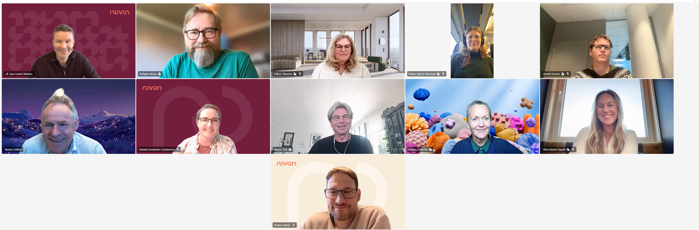

Oppgavene i pilot 2 ligger som issues i [samt-bu-pilot-2](https://github.com/samt-x/samt-bu-pilot-2/issues) og på brettet [SAMT-BU Pilot 2 – Valg av utdanningsløp](https://github.com/orgs/samt-x/projects/2) (Project 2). Denne siden viser hvor arbeidet står.

| Visning | Viser |
|---|---|
| [Board](https://github.com/orgs/samt-x/projects/2/views/1) | Alle oppgaver etter status |
| [By responsible](https://github.com/orgs/samt-x/projects/2/views/2) | Oppgavene gruppert etter hvem som har ansvaret |
| [Open tasks](https://github.com/orgs/samt-x/projects/2/views/3) | Åpne oppgaver i en tabell |
| [My tasks](https://github.com/orgs/samt-x/projects/2/views/5) | Dine oppgaver (krever innlogging) |
| [Timeline](https://github.com/orgs/samt-x/projects/2/views/4) | GitHubs egen tidslinje, uten avhengigheter |

## Opprinnelig plan

Piloten var planlagt fra 2. mai til 30. august 2026, med sprinter på tre uker. Hver sprint skulle starte med et planleggingsmøte og slutte med en demo, med standup for hele piloten annenhver dag.

| Sprint | Periode | Fokus | Leveranse |
|---|---|---|---|
| 1 | 5.–23. mai | Oppstart og nåsituasjon | Forventningsavklaring og start på nåsituasjonen |
| 2 | 26. mai–13. juni | Nåsituasjon, aktører og målbilde | Ferdig nåsituasjon, aktøranalyse og første utkast til målbilde |
| 3 | 16. juni–4. juli | Konsepter og retning | Målbilde, 2–3 scenarier og retningsvalg før sommeren, validert med interessenter i workshop |
| Juli | | Pause | |
| 4 | 4.–22. august | Veien videre og beslutningsgrunnlag | Helhetlig anbefaling: samarbeidsmodell, eierskap og forvaltning, datadeling, arkitektur, informasjonsmodeller, juridiske vurderinger og gevinster |
| Avslutning | 25.–30. august | | Sluttrapport, presentasjon for styringsgruppen og overlevering til SAMT-BU |

Fylkesdirektørkollegiet for kompetanse og utdanning (FKU), som eier vilbli.no, ble orientert om piloten i arbeidsutvalget 8. mai og i kollegiet 22. mai 2026.

Utkastet til forslag om veien videre ble lagt fram på demoen 28. august 2026, se [Løsningsvalg](/pilotering/pilot-2/loesningsvalg/).

## Oppstart

Oppstartsmøtet var onsdag 6. mai 2026, med SAMT-BU-kjerneteamet og ressursene i piloten. Felles møtestruktur ble etablert, og deltakerne gikk gjennom forslag til hva piloten skulle forsøke å besvare. Utfordringsbildet fra et forberedende møte mellom Novari og HK-dir 16. april var:

- en stor jobb med mye data, og fylkene har dataene
- mulig behov for juridisk bistand
- skraping av sidene forekommer i dag, så en ny løsning må bygges for å unngå utilsiktet bruk
- de eksisterende sidene rangerer høyt i søkemotorene, og et nytt nettsted kan miste det
- mulige ekstra kostnader, og gevinster som må utredes
- mulige synergier med pågående arbeid hos HK-dir: Min side, KI-basert søk, chatlogger, geografisk inndeling og digitale skjemaer

Fra høyre øverst: Jens Laurits Nielsen (Novari), Torbjørn Moen (KS Digital), Wenche Fyken (Digdir), Kjersti Stenerud Steien (Digdir), Harald Groven (HK-dir), Martin Zeiffert (Novari), Natalia Kovalenko-Gundersen (Novari), Erik Hagen (Digdir), Cat Holten (Digdir), Ellen Marite Fagerli (HK-dir) og Anders Alstad (Novari).

## Tidslinje

Alle oppgavene på brettet, med pilene for hvilke oppgaver som venter på hverandre. Det som har skjedd, er mørkt. Datoer som mangler, er beregnet og stiplet. Figuren lages fra brettet hver time. Slik leser du den, og slik får en oppgave med: se [Tidslinje](/prosjektleveranser/loesninger/samhandlingsplattform/oppgavestyring/tidslinje/) i oppgavestyringen.


